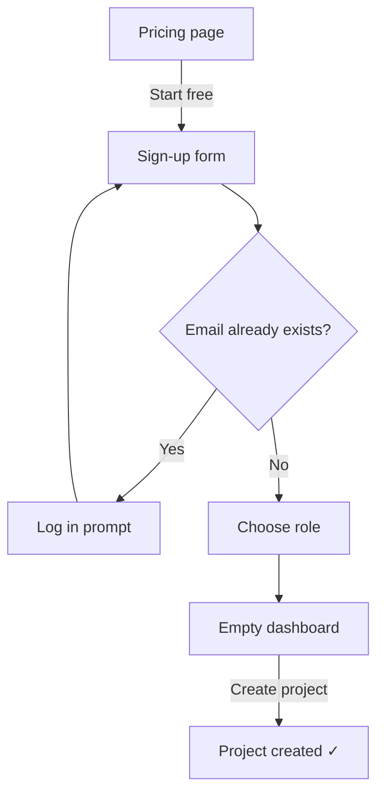

# Output Templates

Use as scaffolding; drop sections that don't apply. Shorter is better when it loses nothing.

## Design from scratch

```
## Summary
[2–3 sentences: what we're designing, for whom, the core approach]

**Assumptions:** [list — invite correction]

## Design direction
[Visual + UX direction in 2–4 sentences, and why it fits the audience]

## User flow
[Entry → steps → success, incl. key unhappy paths]

## Screen layout — [Screen name]
[Text wireframe, top to bottom; mark primary action and emphasis]

## Key components
[Component — variant — purpose — states]

## Tokens (starter)
[Color roles, type scale, spacing — or reference to design system]

## Responsive behavior
| Breakpoint | Layout changes |

## Accessibility
[Specific requirements]

## Next steps
[What to validate / decide / design next]
```

## Text wireframe conventions

```
┌──────────────────────────────────────────────┐
│ [Logo]   Nav · Nav · Nav          [Sign in] │  ← header 64px
├──────────────────────────────────────────────┤
│ H1: Value proposition (text-4xl)             │
│ Supporting line (text-lg, secondary)         │
│ [■ Primary CTA]  [□ Secondary]               │  ← one primary
│ Product screenshot                           │
├──────────────────────────────────────────────┤
│ Logos strip (social proof)                   │
└──────────────────────────────────────────────┘
```
Legend: `■` primary button, `□` secondary, `[ ]` input, `▾` select, `☐` checkbox, `⋯` overflow menu. Annotate sizes/tokens on the right with `←`.

A structured list works too when boxes get unwieldy:
```
1. Header — logo left, 4 nav links, "Sign in" (ghost) + "Start free" (primary) right
2. Hero — H1 / subhead / primary CTA / product image (60% width on desktop, below text on mobile)
```

## User flow

````
## Goal & assumptions
User: … · Goal: … · Success = … · Assumptions: …

## Flow


## Steps
| # | Screen | User intent | Primary action | Error / edge cases |
|---|---|---|---|---|
| 1 | Sign-up form | Create account fast | Create account | Email exists → log in; weak password → inline rule |

## Wireframes
[one annotated ASCII wireframe per key screen + one line each for empty / loading / error / success]

## Flow audit
Steps to goal: N (was M) · Inputs removed: … · Dead ends: none

## Open decisions
- …
````

## Audit / improvement

```
## Summary
[Overall assessment in 2–3 sentences + the single biggest issue]

**Scope:** [what was reviewed; what couldn't be assessed]

## Top priorities
1. ...
2. ...
3. ...

## Findings
### 1. [Title] — Critical
**Observed:** ... **Why it matters:** ... **Recommendation:** ... **Effort:** ...

## What's working
- ...

## Revised design (if "improve" was requested)
[Updated wireframe/spec]

## Validate
- ...
```

## Design system

```
## Summary & principles
[3–4 principles tied to the product, e.g. "Data first: chrome recedes"]

## Foundations
Color (primitive + semantic table with contrast) · Typography scale · Spacing · Radius · Elevation · Motion · Breakpoints

## Tokens
[Paste-ready CSS / JSON / Tailwind]

## Components
[Spec per component: purpose, anatomy, variants, sizes, tokens, states, a11y, do/don't]

## Usage rules
[When to use what; governance light]
```

## Research synthesis

```
## Summary
[Top 3 insights in one line each]

**Source:** N interviews / N survey responses / dates · **Caveats:** sample bias, gaps

## Themes
| Theme (user need) | Evidence | Severity | Representative quote |
|---|---|---|---|
| Can't see who owes money at a glance | 6/8 | High | "I open three tools every Monday…" (P3) |

## Insights → opportunities
1. **Insight:** … **Why it matters:** … **How might we:** … **Hypothesis:** …

## Contradictions & open questions
## Recommended next step
```

## DESIGN.md (persist decisions in a codebase)

```
# Design — [Product]

## Users & purpose
One paragraph: who, core job, context of use.

## Principles
3–4, each one line and specific to the product.

## Direction
Adjectives: … · Layout idea: … · Signature device: … · Density: …

## Tokens
Source of truth: [path to tokens / tailwind config]. Key roles: …

## Typography & spacing
Families, scale, base unit.

## Components
Library: … · Conventions: naming, variants, where components live.

## Do / Don't
- Do … / Don't …

## Accessibility
Target: WCAG 2.2 AA. Project-specific rules.

## Open decisions
```

## Mentorship answer

```
[Direct answer in 1–2 sentences]

**Why:** [the principle]

**Example:** [before → after, concrete]

**When to break it:** [nuance — for intermediate/senior]

**Try this:** [small exercise or next step]
```
